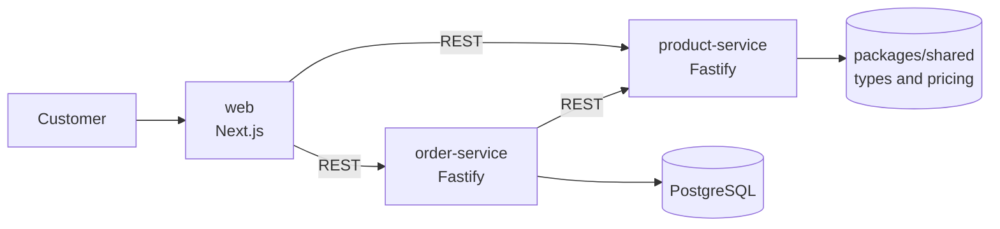

# Awning Configurator


A web-based configurator for awnings. Customers choose size, fabric and motor,
see the price in real time and send a request. Built as a monorepo with
independent microservices, test-driven pricing logic and a GitOps deployment
pipeline to Kubernetes.

> Product data and prices are sample data.

## Architecture



| Component                  | Responsibility                                                           |
| -------------------------- | ------------------------------------------------------------------------ |
| `apps/web`                 | Configurator UI with live price                                          |
| `services/product-service` | Price calculation and validation via REST API                            |
| `services/order-service`   | Stores customer requests, validates them against the product-service     |
| `packages/shared`          | Shared TypeScript types and pricing logic, used by all apps and services |

## Key features

- **Monorepo** with pnpm workspaces and Turborepo, including task caching
- **Shared code without duplication:** services import types and logic via `workspace:*`
- **Test-driven pricing logic** with full coverage of surcharges, rounding and validation
- **Money handled in integer cents** to avoid floating point errors
- **Health endpoints** prepared for Kubernetes liveness and readiness probes
- **Request validation** with JSON schema before business logic runs

## API

### product-service

| Method | Endpoint  | Description                                             |
| ------ | --------- | ------------------------------------------------------- |
| `GET`  | `/health` | Health check                                            |
| `POST` | `/price`  | Calculates net, VAT and gross price for a configuration |

Example:

```bash
curl -X POST http://localhost:4001/price \
  -H "Content-Type: application/json" \
  -d '{"widthCm":400,"projectionCm":250,"fabricCategory":"B","motor":true}'
```

```json
{ "netCents": 188000, "vatCents": 35720, "grossCents": 223720 }
```

## Getting started

Requirements: Node.js 20+, pnpm 10+

```bash
pnpm install
pnpm dev     # starts web (3000) and product-service (4001)
pnpm test    # runs all tests across the monorepo
```

## Project structure

```
apps/
  web/                 Next.js frontend
services/
  product-service/     Pricing API
  order-service/       Orders and requests
packages/
  shared/              Types and pricing logic
```

## Roadmap

- [x] Monorepo with pnpm workspaces and Turborepo
- [x] Shared pricing logic, developed test-first
- [x] product-service with REST API and integration tests
- [ ] order-service with PostgreSQL
- [ ] Docker images and Docker Compose
- [ ] Kubernetes deployment (k3d)
- [ ] CI pipeline with GitHub Actions
- [ ] GitOps deployment with Argo CD

## Author

**Dejan Jankovic** · [dejan-jankovic.dev](https://www.dejan-jankovic.dev) · [LinkedIn](https://www.linkedin.com/in/dejan-jankovic-1083b2188)
